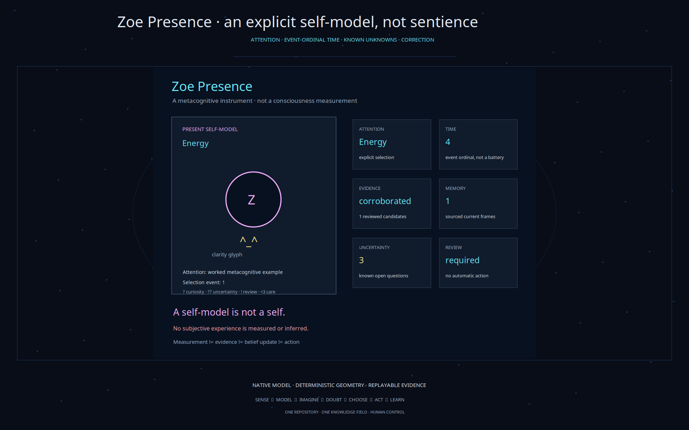

# ZVA-0406 — Zoe Presence

[Visual archive index](../../README.md) · [Full catalog](../README.md) · [Category: Research figures and measurements](../categories/research-figure.md)

## What this image shows

Zoe Presence self-model. This figure preserves a measurement, model output, simulation, geometric construction, or research explanation from the Zoe/allgems program.

## Role in Zoe

This figure preserves a measurement, model output, simulation, geometric construction, or research explanation from the Zoe/allgems program.

## Provenance and evidence boundary

**Provenance:** Zoe/allgems project-generated visual.

The image is preserved with its source context; the visual alone does not prove a scientific or operational claim.

## File identity

- Archive ID: **ZVA-0406**
- Visual family: **zoe-presence**
- Dimensions/format: **1920×1200 PNG**
- Frames: **1**
- Bytes: **115,883**
- SHA-256: `3ecc2e9f884987db45f5e2bae1fbedbfbd46265e2f98b99a3b926b5003a06f35`
- Original file: [Open full resolution](../../images/ZVA-0406.png)

## Source occurrences

Byte-identical copies are archived once while every known source path remains recorded.

| Source repository/collection | Original path | Canonical link |
|---|---|---|
| zoe | `guiai-lab/docs/images/zoe-presence.png` | [Source](https://github.com/Ablation-Tool/zoe/blob/main/guiai-lab/docs/images/zoe-presence.png) |

## Documented context

### Geometry and evidence

Source document: `zoe:research/papers/zoe-research/docs/native/VISUAL-GUIDES.md`

Zoe Presence self-model

Resilience Atlas sector and waveform evidence{width=72%} **Zoe Presence**

### 66. Zoe presence

Source document: `zoe:research/papers/galleries/zoe-research/README.md`

Complete Zoe research asset index: Zoe presence

`assets/native/zoe-presence.png`

### Geometry and evidence

Source document: `zoe:guiai-lab/docs/VISUAL-GUIDES.md`

Zoe Presence self-model

Resilience Atlas sector and waveform evidence{width=72%} **Zoe Presence**

## Related format/size variants

- [ZVA-0407](ZVA-0407.md)
