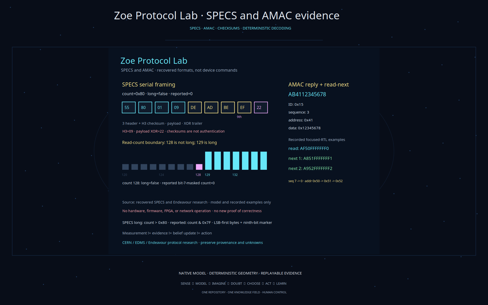

# ZVA-0409 — Zoe Protocol

[Visual archive index](../../README.md) · [Full catalog](../README.md) · [Category: Research figures and measurements](../categories/research-figure.md)

## What this image shows

SPECS and AMAC protocol evidence. This visual belongs to Zoe’s CERN/source-evidence program, helping a reader inspect a corpus, protocol, replay, virtual system, or process boundary.

## Role in Zoe

This visual belongs to Zoe’s CERN/source-evidence program, helping a reader inspect a corpus, protocol, replay, virtual system, or process boundary.

## Provenance and evidence boundary

**Provenance:** Zoe/allgems project-generated visual.

The image is preserved with its source context; the visual alone does not prove a scientific or operational claim.

## File identity

- Archive ID: **ZVA-0409**
- Visual family: **zoe-protocol**
- Dimensions/format: **1920×1200 PNG**
- Frames: **1**
- Bytes: **145,304**
- SHA-256: `03d9f96008d56d2a26c5703c2abee8434208c2a580010652cca7f47889fc258e`
- Original file: [Open full resolution](../../images/ZVA-0409.png)

## Source occurrences

Byte-identical copies are archived once while every known source path remains recorded.

| Source repository/collection | Original path | Canonical link |
|---|---|---|
| zoe | `guiai-lab/docs/images/zoe-protocol.png` | [Source](https://github.com/Ablation-Tool/zoe/blob/main/guiai-lab/docs/images/zoe-protocol.png) |

## Documented context

### Geometry and evidence

Source document: `zoe:research/papers/zoe-research/docs/native/VISUAL-GUIDES.md`

SPECS and AMAC protocol evidence

Zoe Presence self-model{width=72%} **Zoe Protocol Lab**

### 8. Zoe protocol

Source document: `zoe:research/papers/galleries/zoe-cern/README.md`

CERN research in Zoe — Visual research index: Zoe protocol

`assets/native/zoe-protocol.png`

### 69. Zoe protocol

Source document: `zoe:research/papers/galleries/zoe-research/README.md`

Complete Zoe research asset index: Zoe protocol

`assets/native/zoe-protocol.png`

### Geometry and evidence

Source document: `zoe:guiai-lab/docs/VISUAL-GUIDES.md`

SPECS and AMAC protocol evidence

Zoe Presence self-model{width=72%} **Zoe Protocol Lab**

## Related format/size variants

- [ZVA-0410](ZVA-0410.md)
