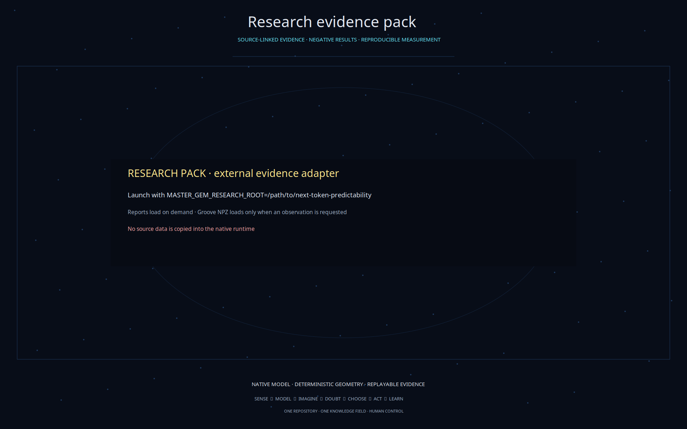

# ZVA-0414 — Zoe Research

[Visual archive index](../../README.md) · [Full catalog](../README.md) · [Category: Research figures and measurements](../categories/research-figure.md)

## What this image shows

Complete Zoe research asset index: Zoe research. This figure preserves a measurement, model output, simulation, geometric construction, or research explanation from the Zoe/allgems program.

## Role in Zoe

This figure preserves a measurement, model output, simulation, geometric construction, or research explanation from the Zoe/allgems program.

## Provenance and evidence boundary

**Provenance:** Zoe/allgems project-generated visual.

The image is preserved with its source context; the visual alone does not prove a scientific or operational claim.

## File identity

- Archive ID: **ZVA-0414**
- Visual family: **zoe-research**
- Dimensions/format: **1920×1200 PNG**
- Frames: **1**
- Bytes: **81,967**
- SHA-256: `e23b624c44fa4e660376e342f1fb9ae3aad8b099b539167479a816446d7c7232`
- Original file: [Open full resolution](../../images/ZVA-0414.png)

## Source occurrences

Byte-identical copies are archived once while every known source path remains recorded.

| Source repository/collection | Original path | Canonical link |
|---|---|---|
| zoe | `guiai-lab/docs/images/zoe-research.png` | [Source](https://github.com/Ablation-Tool/zoe/blob/main/guiai-lab/docs/images/zoe-research.png) |

## Documented context

### 74. Zoe research

Source document: `zoe:research/papers/galleries/zoe-research/README.md`

Complete Zoe research asset index: Zoe research

`assets/native/zoe-research.png`

## Related format/size variants

- [ZVA-0415](ZVA-0415.md)
