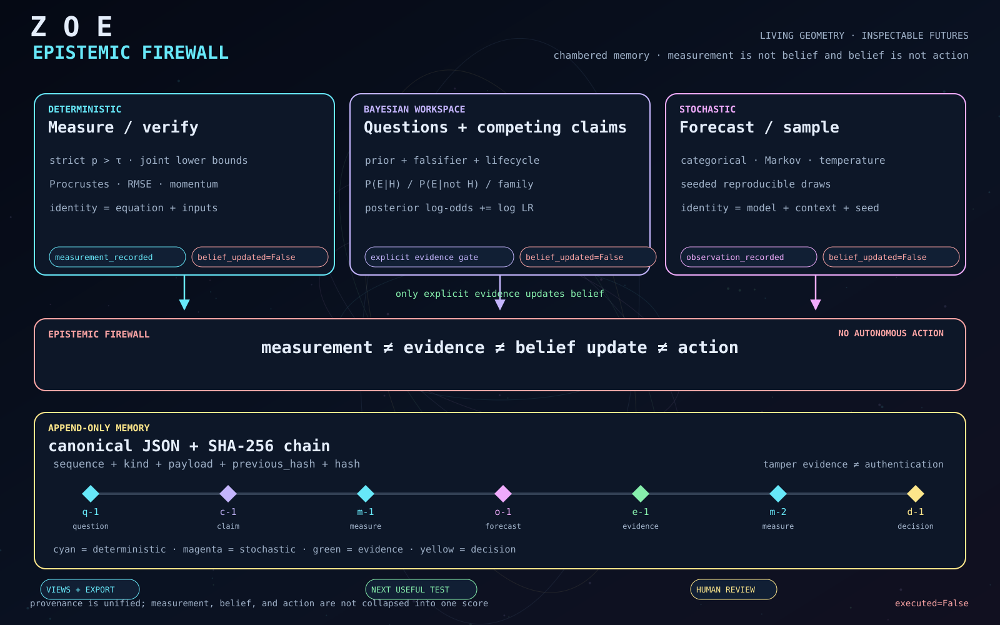

# ZVA-0421 — 01 Epistemic Firewall

[Visual archive index](../../README.md) · [Full catalog](../README.md) · [Category: Mechanism and architecture diagrams](../categories/mechanism-diagram.md)

## What this image shows

Complete Zoe research asset index: 01 epistemic firewall. This diagram explains relationships among components, evidence states, measurements, or decisions without requiring the reader to reconstruct the architecture from code.

## Role in Zoe

This diagram explains relationships among components, evidence states, measurements, or decisions without requiring the reader to reconstruct the architecture from code.

## Provenance and evidence boundary

**Provenance:** Zoe/allgems project-generated visual.

The image is preserved with its source context; the visual alone does not prove a scientific or operational claim.

## File identity

- Archive ID: **ZVA-0421**
- Visual family: **01-epistemic-firewall**
- Dimensions/format: **SVG 1600×1000**
- Frames: **vector/not applicable**
- Bytes: **21,735**
- SHA-256: `7839a67162a18f2e29c417e0797e08c57130062fe801939c4a618e897037ac8e`
- Original file: [Open full resolution](../../images/ZVA-0421.svg)

## Source occurrences

Byte-identical copies are archived once while every known source path remains recorded.

| Source repository/collection | Original path | Canonical link |
|---|---|---|
| zoe | `guiai-lab/docs/images/zoe-visuals/01-epistemic-firewall.svg` | [Source](https://github.com/Ablation-Tool/zoe/blob/main/guiai-lab/docs/images/zoe-visuals/01-epistemic-firewall.svg) |

## Documented context

### 81. 01 epistemic firewall

Source document: `zoe:research/papers/galleries/zoe-research/README.md`

Complete Zoe research asset index: 01 epistemic firewall

`assets/native/zoe-visuals/01-epistemic-firewall.svg`

## Related format/size variants

- [ZVA-0316](ZVA-0316.md)
- [ZVA-0317](ZVA-0317.md)
