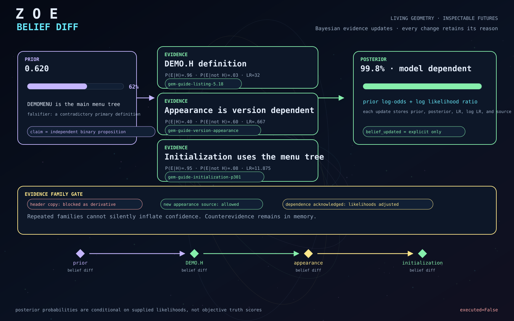

# ZVA-0423 — 02 Belief Diff

[Visual archive index](../../README.md) · [Full catalog](../README.md) · [Category: Mechanism and architecture diagrams](../categories/mechanism-diagram.md)

## What this image shows

Complete Zoe research asset index: 02 belief diff. This diagram explains relationships among components, evidence states, measurements, or decisions without requiring the reader to reconstruct the architecture from code.

## Role in Zoe

This diagram explains relationships among components, evidence states, measurements, or decisions without requiring the reader to reconstruct the architecture from code.

## Provenance and evidence boundary

**Provenance:** Zoe/allgems project-generated visual.

The image is preserved with its source context; the visual alone does not prove a scientific or operational claim.

## File identity

- Archive ID: **ZVA-0423**
- Visual family: **02-belief-diff**
- Dimensions/format: **SVG 1600×1000**
- Frames: **vector/not applicable**
- Bytes: **20,841**
- SHA-256: `1ba7d124ed5b80f55ecf750d876f013a2ff902314292951f8150b5e6a61af70b`
- Original file: [Open full resolution](../../images/ZVA-0423.svg)

## Source occurrences

Byte-identical copies are archived once while every known source path remains recorded.

| Source repository/collection | Original path | Canonical link |
|---|---|---|
| zoe | `guiai-lab/docs/images/zoe-visuals/02-belief-diff.svg` | [Source](https://github.com/Ablation-Tool/zoe/blob/main/guiai-lab/docs/images/zoe-visuals/02-belief-diff.svg) |

## Documented context

### 83. 02 belief diff

Source document: `zoe:research/papers/galleries/zoe-research/README.md`

Complete Zoe research asset index: 02 belief diff

`assets/native/zoe-visuals/02-belief-diff.svg`

## Related format/size variants

- [ZVA-0318](ZVA-0318.md)
- [ZVA-0319](ZVA-0319.md)
- [ZVA-0422](ZVA-0422.md)
