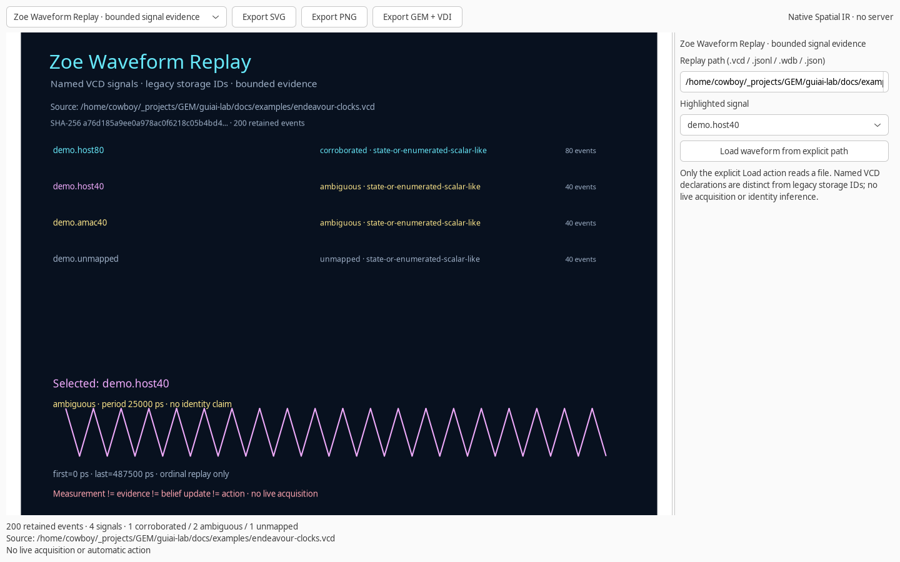

# ZVA-0426 — Zoe Waveform Native

[Visual archive index](../../README.md) · [Full catalog](../README.md) · [Category: Native interfaces and application scenes](../categories/interface.md)

## What this image shows

Native Zoe Waveform Replay. This visual belongs to Zoe’s CERN/source-evidence program, helping a reader inspect a corpus, protocol, replay, virtual system, or process boundary.

## Role in Zoe

This visual belongs to Zoe’s CERN/source-evidence program, helping a reader inspect a corpus, protocol, replay, virtual system, or process boundary.

## Provenance and evidence boundary

**Provenance:** Zoe project interface capture.

A screenshot documents the displayed interface state; it is not independent experimental validation.

## File identity

- Archive ID: **ZVA-0426**
- Visual family: **zoe-waveform-native**
- Dimensions/format: **1440×900 PNG**
- Frames: **1**
- Bytes: **114,618**
- SHA-256: `e0a0049d1eff5247860efd0303901ffacada7c3fb2b024d85a497437b1be3334`
- Original file: [Open full resolution](../../images/ZVA-0426.png)

## Source occurrences

Byte-identical copies are archived once while every known source path remains recorded.

| Source repository/collection | Original path | Canonical link |
|---|---|---|
| zoe | `guiai-lab/docs/images/zoe-waveform-native.png` | [Source](https://github.com/Ablation-Tool/zoe/blob/main/guiai-lab/docs/images/zoe-waveform-native.png) |

## Documented context

### Verification

Source document: `zoe:research/papers/zoe-research/docs/native/WAVEFORM.md`

Native Zoe Waveform Replay

The native screenshot below shows the actual selector and explicit loading controls.

### 7. Zoe waveform native

Source document: `zoe:research/papers/galleries/zoe-cern/README.md`

CERN research in Zoe — Visual research index: Zoe waveform native

`assets/native/zoe-waveform-native.png`

### 90. Zoe waveform native

Source document: `zoe:research/papers/galleries/zoe-research/README.md`

Complete Zoe research asset index: Zoe waveform native

`assets/native/zoe-waveform-native.png`

### Verification

Source document: `zoe:guiai-lab/docs/WAVEFORM.md`

Native Zoe Waveform Replay

The native screenshot below shows the actual selector and explicit loading controls.
