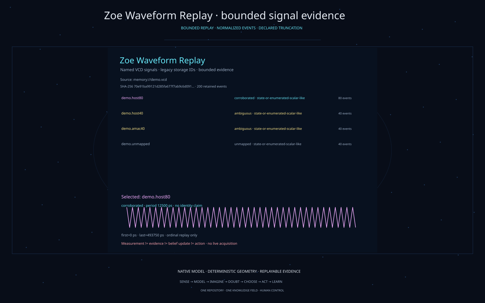

# ZVA-0428 — Zoe Waveform

[Visual archive index](../../README.md) · [Full catalog](../README.md) · [Category: Research figures and measurements](../categories/research-figure.md)

## What this image shows

Complete Zoe research asset index: Zoe waveform. This visual belongs to Zoe’s CERN/source-evidence program, helping a reader inspect a corpus, protocol, replay, virtual system, or process boundary.

## Role in Zoe

This visual belongs to Zoe’s CERN/source-evidence program, helping a reader inspect a corpus, protocol, replay, virtual system, or process boundary.

## Provenance and evidence boundary

**Provenance:** Zoe/allgems project-generated visual.

The image is preserved with its source context; the visual alone does not prove a scientific or operational claim.

## File identity

- Archive ID: **ZVA-0428**
- Visual family: **zoe-waveform**
- Dimensions/format: **SVG 1920×1200**
- Frames: **vector/not applicable**
- Bytes: **26,400**
- SHA-256: `5c5c1110354d35ef2558f835ca991ac1e31bbd63a9c9599c94ca23d6f2c238fe`
- Original file: [Open full resolution](../../images/ZVA-0428.svg)

## Source occurrences

Byte-identical copies are archived once while every known source path remains recorded.

| Source repository/collection | Original path | Canonical link |
|---|---|---|
| zoe | `guiai-lab/docs/images/zoe-waveform.svg` | [Source](https://github.com/Ablation-Tool/zoe/blob/main/guiai-lab/docs/images/zoe-waveform.svg) |

## Documented context

### 92. Zoe waveform

Source document: `zoe:research/papers/galleries/zoe-research/README.md`

Complete Zoe research asset index: Zoe waveform

`assets/native/zoe-waveform.svg`

## Related format/size variants

- [ZVA-0021](ZVA-0021.md)
- [ZVA-0022](ZVA-0022.md)
- [ZVA-0158](ZVA-0158.md)
- [ZVA-0427](ZVA-0427.md)
