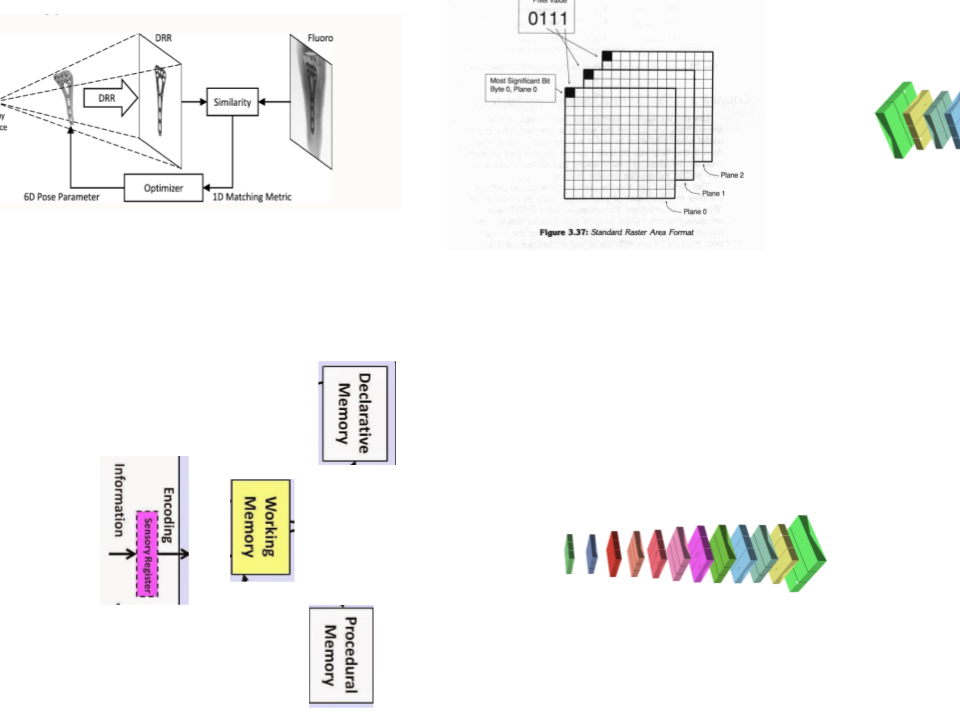

# ZVA-0430 — Reference Memory Flow

[Visual archive index](../../README.md) · [Full catalog](../README.md) · [Category: Source references and derivative reading copies](../categories/reference.md)

## What this image shows

Reference Memory Flow is a source references and derivative reading copies asset from the guiai-lab portion of the Zoe/allgems project. This asset preserves source context or a derivative reading view so that generated interpretations remain distinguishable from their references.

## Role in Zoe

This asset preserves source context or a derivative reading view so that generated interpretations remain distinguishable from their references.

## Provenance and evidence boundary

**Provenance:** Source-derived reference visual.

Reference material is retained for provenance and is not automatically original Zoe artwork.

## File identity

- Archive ID: **ZVA-0430**
- Visual family: **reference-memory-flow**
- Dimensions/format: **960×720 PNG**
- Frames: **1**
- Bytes: **183,188**
- SHA-256: `04e2fce43f62492adc31f0b8ad5a6332a2e8a66e61586555c4abb9d7264a989d`
- Original file: [Open full resolution](../../images/ZVA-0430.png)

## Source occurrences

Byte-identical copies are archived once while every known source path remains recorded.

| Source repository/collection | Original path | Canonical link |
|---|---|---|
| zoe | `guiai-lab/docs/references/cognitive-field/reference-memory-flow.png` | [Source](https://github.com/Ablation-Tool/zoe/blob/main/guiai-lab/docs/references/cognitive-field/reference-memory-flow.png) |
