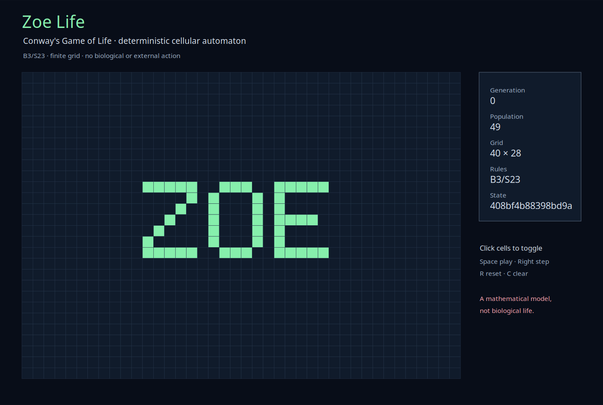

# ZVA-0432 — Life Text

[Visual archive index](../../README.md) · [Full catalog](../README.md) · [Category: Artwork and generative compositions](../categories/artwork.md)

## What this image shows

Zoe Life used as a typographic and cellular instrument: text-shaped content is rendered into the cell field rather than treated as an ordinary image caption. This is part of Zoe’s creative geometry and generative-art practice, preserving the artistic side of the project alongside its scientific instruments.

## Role in Zoe

This is part of Zoe’s creative geometry and generative-art practice, preserving the artistic side of the project alongside its scientific instruments.

## Provenance and evidence boundary

**Provenance:** Zoe/allgems project-generated visual.

The image is preserved with its source context; the visual alone does not prove a scientific or operational claim.

## File identity

- Archive ID: **ZVA-0432**
- Visual family: **life-text**
- Dimensions/format: **1400×942 PNG**
- Frames: **1**
- Bytes: **55,473**
- SHA-256: `b80ed0a0522c5bcd46dbf0e5d06bc9911c46cef5d1c10ee4729dcabd215639f4`
- Original file: [Open full resolution](../../images/ZVA-0432.png)

## Source occurrences

Byte-identical copies are archived once while every known source path remains recorded.

| Source repository/collection | Original path | Canonical link |
|---|---|---|
| zoe | `life-text.png` | [Source](https://github.com/Ablation-Tool/zoe/blob/main/life-text.png) |
