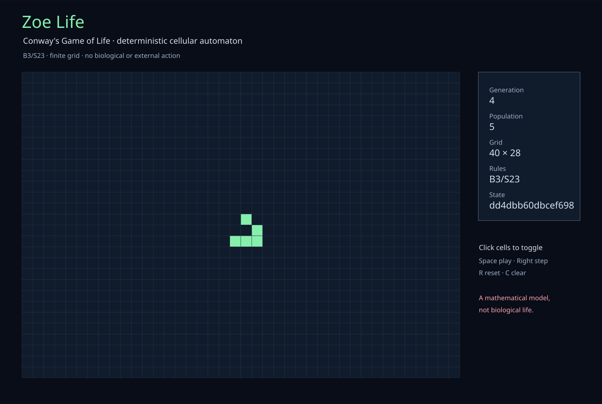

# ZVA-0434 — Life

[Visual archive index](../../README.md) · [Full catalog](../README.md) · [Category: Artwork and generative compositions](../categories/artwork.md)

## What this image shows

A deterministic Conway Game of Life state rendered as a colored cellular field. The PNG is a raster presentation and the SVG is an independently viewable vector scene of the same model family.

## Role in Zoe

This is part of Zoe’s creative geometry and generative-art practice, preserving the artistic side of the project alongside its scientific instruments.

## Provenance and evidence boundary

**Provenance:** Zoe/allgems project-generated visual.

The image is preserved with its source context; the visual alone does not prove a scientific or operational claim.

## File identity

- Archive ID: **ZVA-0434**
- Visual family: **life**
- Dimensions/format: **SVG 1400×942**
- Frames: **vector/not applicable**
- Bytes: **206,379**
- SHA-256: `1428a544edfcf850728a69cbcab3e981f48a6494df460d5e9aa81216725f3b4a`
- Original file: [Open full resolution](../../images/ZVA-0434.svg)

## Source occurrences

Byte-identical copies are archived once while every known source path remains recorded.

| Source repository/collection | Original path | Canonical link |
|---|---|---|
| zoe | `life.svg` | [Source](https://github.com/Ablation-Tool/zoe/blob/main/life.svg) |

## Related format/size variants

- [ZVA-0433](ZVA-0433.md)
