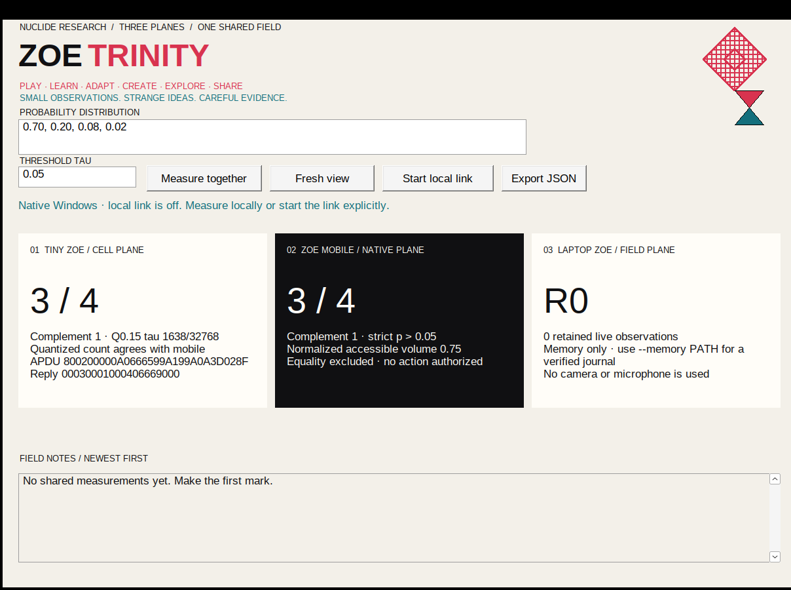

# ZVA-0450 — Zoetrinity

[Visual archive index](../../README.md) · [Full catalog](../README.md) · [Category: Native interfaces and application scenes](../categories/interface.md)

## What this image shows

Native Zoe Trinity for Windows. This image documents a native, mobile, browser, or desktop interface and its available controls at a particular recorded state.

## Role in Zoe

This image documents a native, mobile, browser, or desktop interface and its available controls at a particular recorded state.

## Provenance and evidence boundary

**Provenance:** Zoe/allgems project-generated visual.

The image is preserved with its source context; the visual alone does not prove a scientific or operational claim.

## File identity

- Archive ID: **ZVA-0450**
- Visual family: **zoetrinity**
- Dimensions/format: **1208×900 PNG**
- Frames: **1**
- Bytes: **85,016**
- SHA-256: `e48a8ba541102f95fa5ee459bdde7e34668419a4e6ad8fb1b20357a2434c575b`
- Original file: [Open full resolution](../../images/ZVA-0450.png)

## Source occurrences

Byte-identical copies are archived once while every known source path remains recorded.

| Source repository/collection | Original path | Canonical link |
|---|---|---|
| zoe | `mobile/dist/windows/ZoeTrinity.png` | [Source](https://github.com/Ablation-Tool/zoe/blob/main/mobile/dist/windows/ZoeTrinity.png) |
| zoe | `mobile/docs/images/zoe-trinity-native-windows.png` | [Source](https://github.com/Ablation-Tool/zoe/blob/main/mobile/docs/images/zoe-trinity-native-windows.png) |

## Documented context

### Native Windows + Pixel or Apple

Source document: `zoe:mobile/TRINITY.md`

Native Zoe Trinity for Windows

Equality is excluded. The mobile plane measures the supplied floating-point values. Tiny measures the largest-remainder Q0.15 representation, whose unsigned values sum to exactly 32,768. Both results and any count difference remain visible. A measurement is an observation, not correctness, evidence, belief, or authorization.
