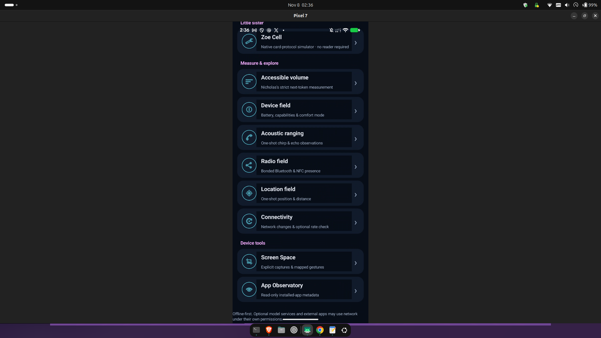

# ZVA-0451 — Zoe Pixel Field

[Visual archive index](../../README.md) · [Full catalog](../README.md) · [Category: Native interfaces and application scenes](../categories/interface.md)

## What this image shows

The mobile Zoe pixel-field scene, presenting a compact interactive visual field within the Trinity/mobile environment. This image documents a native, mobile, browser, or desktop interface and its available controls at a particular recorded state.

## Role in Zoe

This image documents a native, mobile, browser, or desktop interface and its available controls at a particular recorded state.

## Provenance and evidence boundary

**Provenance:** Zoe/allgems project-generated visual.

The image is preserved with its source context; the visual alone does not prove a scientific or operational claim.

## File identity

- Archive ID: **ZVA-0451**
- Visual family: **zoe-pixel-field**
- Dimensions/format: **1920×1080 PNG**
- Frames: **1**
- Bytes: **285,176**
- SHA-256: `050b3db36e9717e2fef9564bc9d0beacb361c0d1ea728f9dd844f7b4cd05b316`
- Original file: [Open full resolution](../../images/ZVA-0451.png)

## Source occurrences

Byte-identical copies are archived once while every known source path remains recorded.

| Source repository/collection | Original path | Canonical link |
|---|---|---|
| zoe | `mobile/docs/images/zoe-pixel-field.png` | [Source](https://github.com/Ablation-Tool/zoe/blob/main/mobile/docs/images/zoe-pixel-field.png) |
