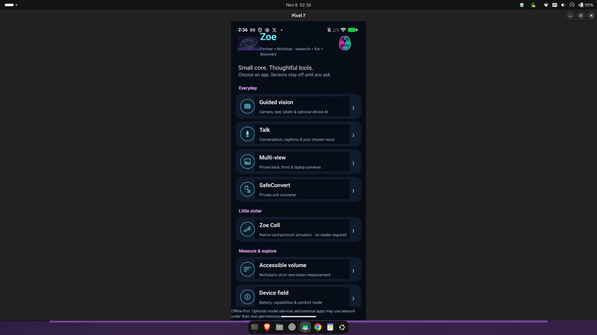

# ZVA-0452 — Zoe Pixel Home

[Visual archive index](../../README.md) · [Full catalog](../README.md) · [Category: Native interfaces and application scenes](../categories/interface.md)

## What this image shows

The mobile Zoe home interface and its pixel-based visual identity, optimized for a small screen. This image documents a native, mobile, browser, or desktop interface and its available controls at a particular recorded state.

## Role in Zoe

This image documents a native, mobile, browser, or desktop interface and its available controls at a particular recorded state.

## Provenance and evidence boundary

**Provenance:** Zoe/allgems project-generated visual.

The image is preserved with its source context; the visual alone does not prove a scientific or operational claim.

## File identity

- Archive ID: **ZVA-0452**
- Visual family: **zoe-pixel-home**
- Dimensions/format: **1920×1080 PNG**
- Frames: **1**
- Bytes: **271,377**
- SHA-256: `65e27fa37f97bccc09c6675aa7d394e9de5b0ebd3e54ad5c851da6f27d2fb282`
- Original file: [Open full resolution](../../images/ZVA-0452.png)

## Source occurrences

Byte-identical copies are archived once while every known source path remains recorded.

| Source repository/collection | Original path | Canonical link |
|---|---|---|
| zoe | `mobile/docs/images/zoe-pixel-home.png` | [Source](https://github.com/Ablation-Tool/zoe/blob/main/mobile/docs/images/zoe-pixel-home.png) |
