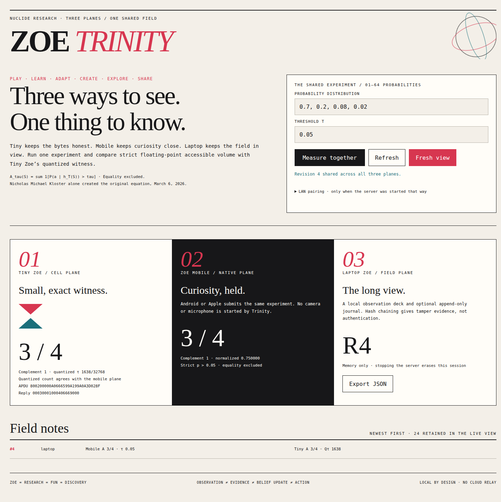

# ZVA-0453 — Zoe Trinity Deck

[Visual archive index](../../README.md) · [Full catalog](../README.md) · [Category: Native interfaces and application scenes](../categories/interface.md)

## What this image shows

The Zoe Trinity deck view, organizing Tiny, mobile, and laptop measurement workflows into an inspectable deck. This image documents a native, mobile, browser, or desktop interface and its available controls at a particular recorded state.

## Role in Zoe

This image documents a native, mobile, browser, or desktop interface and its available controls at a particular recorded state.

## Provenance and evidence boundary

**Provenance:** Zoe/allgems project-generated visual.

The image is preserved with its source context; the visual alone does not prove a scientific or operational claim.

## File identity

- Archive ID: **ZVA-0453**
- Visual family: **zoe-trinity-deck**
- Dimensions/format: **1425×1427 PNG**
- Frames: **1**
- Bytes: **195,124**
- SHA-256: `8a570e5019ed3d861b5ac3dd54ebdd13f1f987eef5b18a1f7901a5b77776f2af`
- Original file: [Open full resolution](../../images/ZVA-0453.png)

## Source occurrences

Byte-identical copies are archived once while every known source path remains recorded.

| Source repository/collection | Original path | Canonical link |
|---|---|---|
| zoe | `mobile/docs/images/zoe-trinity-deck.png` | [Source](https://github.com/Ablation-Tool/zoe/blob/main/mobile/docs/images/zoe-trinity-deck.png) |

## Documented context

### Zoe Trinity

Source document: `zoe:mobile/TRINITY.md`

Zoe Trinity laptop observation deck

**Tiny Zoe + Zoe mobile + laptop Zoe — three coordinated planes, one shared experiment.** Trinity is a local research instrument, not three minds, a cloud account, a distributed model, or an autonomous agent.
